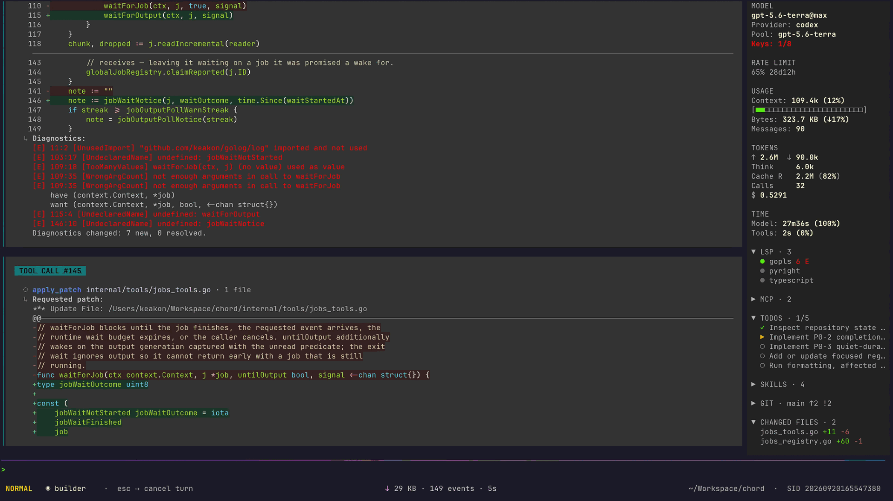

<p align="center">
  <picture>
    <source media="(prefers-color-scheme: dark)" srcset="./assets/logo/chord-wordmark-dark.svg">
    
  </picture>
</p>

<p align="center"><strong>A faster, cheaper, lighter terminal coding agent.</strong></p>

<p align="center">In one measured task: about 1/3 of Claude Code's time and cost.</p>

<p align="center">A session uses tens of megabytes of memory (39MB after 200 messages in our test), so you can run several agents at once even on modest hardware.</p>

<p align="center">
  <a href="./docs/quickstart.md">Quickstart</a> ·
  <a href="./docs/model-choice.md#supported-accounts-and-apis">Model access</a> ·
  <a href="https://keakon.github.io/chord/">Docs site</a> ·
  <a href="./README_CN.md">中文 README</a>
</p>

<p align="center">
  <a href="https://github.com/keakon/chord/actions/workflows/ci.yml"></a>
  <a href="https://github.com/keakon/chord/releases"></a>
  <a href="./go.mod"></a>
  <a href="./LICENSE"></a>
</p>

<p align="center">
  
</p>

## Measured results

### Adding streaming JSON iteration to httpx

Six coding agents each ran the same [DeepSWE v1.1 task](https://deepswe.datacurve.ai/data/v1.1/tasks/httpx-streaming-json-iteration) on the same model: add streaming JSON iteration to the Python HTTP client `httpx`, handling decoding errors and single-use responses. All runs used `deepseek-flash`, now served by DeepSeek-V4.1-Flash-1017. Time includes model interactions, code changes, and test execution, but excludes environment setup and final cleanup.

| Harness | Time | Estimated cost |
|---------|------|------|
| Chord 0.8.1 | **6m37s** | **$0.052** |
| deepseek-harness 0.1.5-rc.1 | 9m50s (1.49×) | $0.079 (1.51×) |
| pi 0.85.1 | 10m22s (1.57×) | $0.086 (1.65×) |
| codex 0.154.0 | 17m01s (2.57×) | $0.139 (2.67×) |
| mini-swe-agent 2.4.6 | 18m29s (2.79×) | $0.125 (2.40×) |
| claude code 2.1.272 | 22m25s (3.39×) | $0.166 (3.17×) |

Multipliers are relative to Chord. Chord was fastest and cheapest, and used the fewest input and output tokens (54,530 / 58,559).

Chord trims old tool output when building each request, compacts long-session context, and starts safe tools as soon as their arguments are complete; see [Performance](./docs/performance.md#how-it-works) for details.

### App memory

Memory measured on macOS 15.3.2 (arm64), with an empty session and after loading 200 messages:

| Harness | Empty session | 200 messages | Growth |
|---------|---------------|--------------|--------|
| Chord 0.8.1 | 30MB | **39MB** | **+9MB** |
| codex 0.154.0 | **27MB** | 47MB | +20MB |
| claude code 2.1.273 | 143MB | 216MB | +73MB |

One measured task and one memory test; your numbers will differ. [See the token breakdown and test conditions](./docs/performance.md#measured-results).

## Three-step setup

### 1. Install

Download the archive for your OS and architecture from [GitHub Releases](https://github.com/keakon/chord/releases), extract it, and put `chord` on your `PATH`. No Go installation is needed. Verify the installation:

```bash
chord --version
```

On macOS, the downloaded binary may be blocked on first run; see [Quickstart](./docs/quickstart.md#1-install) for the steps to unblock it.

You can also install with Go 1.27.0 or newer:

```bash
go install github.com/keakon/chord/cmd/chord@latest
```

The default `GOTOOLCHAIN=auto` downloads the required toolchain when needed.

### 2. Start in your project

Open your project in an interactive terminal:

```bash
cd my-project
chord
```

On the first run without a configuration file, the wizard guides you through entering your model API URL, model name, and API key, or signing in with Codex OAuth.

See [supported accounts and APIs](./docs/model-choice.md#supported-accounts-and-apis) to check compatibility with your existing keys or accounts. For detailed steps, see [Quickstart](./docs/quickstart.md).

### 3. Send your first task

Describe what you want and press `Enter`. For example, have it read through your project first:

```text
Explain this project's main modules and how to run its tests. Do not change any files yet.
```

Read its answer. With the default configuration, Chord edits files and runs commands directly; only file deletions through the `delete` tool ask first. To approve actions before they run, see [Permissions & Safety](./docs/permissions-and-safety.md). Once you are comfortable, give Chord a specific change: it edits code and runs tests, and you review the diff in the terminal.

Press `Esc` to enter Normal mode, then `q` to quit. Run `chord --continue` from the same project directory next time to resume the most recent session.

## More features

- [Automatic model fallback](./docs/configuration.md#model-pools-selecting-providermodel): configure multiple models so Chord can automatically try the next model when a request fails.
- [Import existing sessions](./docs/usage.md#importing-external-sessions): bring your Claude Code, Codex, or OpenCode history into Chord and continue working.
- [Vim-style keyboard controls](./docs/keybindings.md): browse sessions, operate tool cards, and switch panels from the keyboard.

## Find a guide

- [Quickstart](./docs/quickstart.md): install, connect a model, and complete your first task
- [Usage](./docs/usage.md): everyday controls, session recovery, long tasks, and parallel work
- [Model configuration](./docs/model-configs.md) · [Configuration examples](./docs/examples/index.md): connect models or custom gateways
- [Permissions & Safety](./docs/permissions-and-safety.md): choose which actions need approval
- [Customization](./docs/customization.md): configure multiple agents, skills, code diagnostics, and external tools
- [Headless](./docs/headless.md): control Chord from another interface with `chord headless`
- [ACP agent mode](./docs/acp.md): drive Chord from ACP clients such as Zed with `chord acp`
- [Troubleshooting](./docs/troubleshooting.md) · [Full documentation index](./docs/index.md)

## Project links

- Companion: [keakon/chord-gateway](https://github.com/keakon/chord-gateway)
- [Contributing](./CONTRIBUTING.md)
- [Changelog](./CHANGELOG.md)
- [Issues](https://github.com/keakon/chord/issues)

## Platform support

Chord is developed and tested primarily on macOS. Linux works well; Windows mostly works but may have undiscovered bugs. Some features (`prevent_sleep`) are macOS-only and silently no-op elsewhere. See [Platform support](./docs/platforms.md) for the per-feature matrix.

## Acknowledgements

Chord is built on [Bubble Tea](https://github.com/charmbracelet/bubbletea), with design and feature inspiration from Claude Code, Codex, OpenCode, and Crush. Most of its development was assisted by GPT-5.4/5.5. Thanks to the many community-run API proxies on [linux.do](https://linux.do/) for providing token access.

## License

MIT License. See [LICENSE](./LICENSE).
