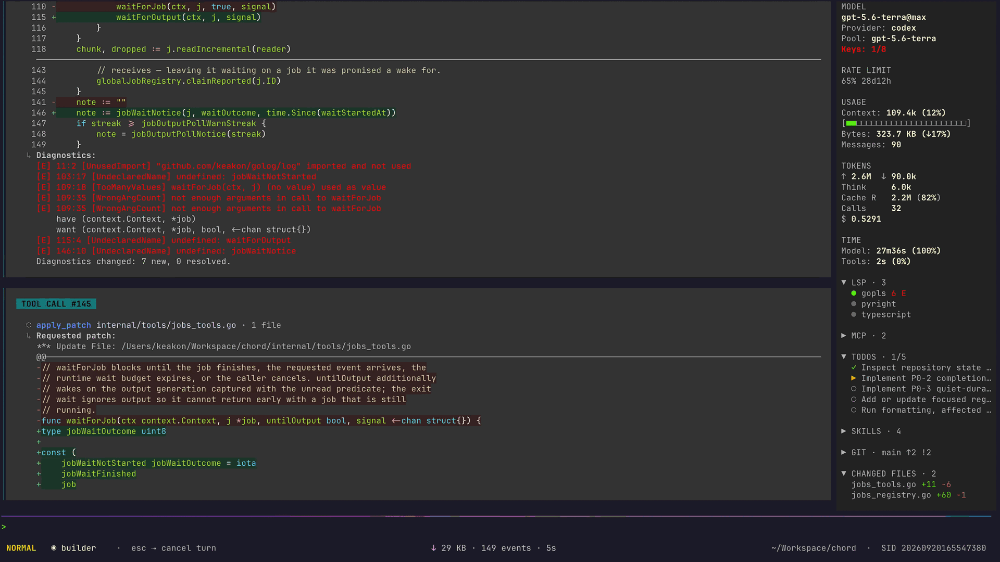

<p align="center">
  <picture>
    <source media="(prefers-color-scheme: dark)" srcset="./assets/logo/chord-wordmark-dark.svg">
    
  </picture>
</p>

<p align="center">
  <strong>更快、更省、更轻的终端 Coding Agent。</strong><br>
  单次任务实测：<strong>耗时和成本约为 Claude Code 的 1/3。</strong><br>
  单个会话只占几十 MB 内存，配置不高的电脑也能同时跑多个 Agent。
</p>

<p align="center">
  <a href="./docs/quickstart_CN.md">快速开始</a> ·
  <a href="./docs/model-choice_CN.md#账号与-api-支持">模型接入</a> ·
  <a href="https://keakon.github.io/chord/zh/">文档站</a> ·
  <a href="./README.md">English README</a>
</p>

<p align="center">
  <a href="https://github.com/keakon/chord/actions/workflows/ci.yml"></a>
  <a href="https://github.com/keakon/chord/releases"></a>
  <a href="./go.mod"></a>
  <a href="./LICENSE"></a>
</p>

<p align="center">
  
</p>

## 实测数据

六款编程 Agent 用同一模型（`deepseek-flash`）完成同一 [DeepSWE v1.1 任务](https://deepswe.datacurve.ai/data/v1.1/tasks/httpx-streaming-json-iteration)，Chord 用时最短、成本最低：

| 工具 | 耗时 | 估算成本 |
|---------|------|------|
| Chord 0.8.1 | **6m37s** | **￥0.348** |
| deepseek-harness 0.1.5-rc.1 | 9m50s（1.49 倍） | ￥0.527（1.51 倍） |
| pi 0.85.1 | 10m22s（1.57 倍） | ￥0.576（1.65 倍） |
| Codex 0.154.0 | 17m01s（2.57 倍） | ￥0.929（2.67 倍） |
| mini-swe-agent 2.4.6 | 18m29s（2.79 倍） | ￥0.835（2.40 倍） |
| Claude Code 2.1.272 | 22m25s（3.39 倍） | ￥1.104（3.17 倍） |

加载 200 条消息后，Chord 占用 39 MB 内存（Claude Code：216 MB）。以上数据来自一次任务实测和一次内存测试，不代表普遍结果；token 明细与测量条件见[性能](./docs/performance_CN.md#实测数据)。

## 三步上手

### 1. 安装

macOS 或 Linux 已安装 [Homebrew](https://brew.sh) 时：

```bash
brew install keakon/tap/chord
chord --version
```

Windows 从 [GitHub Releases](https://github.com/keakon/chord/releases) 下载压缩包，解压后把 `chord` 加入 `PATH`。

<details>
<summary>用 Go 安装</summary>

使用 Go 1.27.0 或更新版本：

```bash
go install github.com/keakon/chord/cmd/chord@latest
```

</details>

升级方法、macOS 下载版被系统阻止时的处理见[快速开始](./docs/quickstart_CN.md#1-安装)。

### 2. 在项目里启动

在交互式终端进入项目目录：

```bash
cd my-project
chord
```

首次运行会进入向导：填写模型 API 地址、模型名称和 API key，或通过 Codex OAuth 登录。已有账号或 API 是否支持，见[账号与 API 支持](./docs/model-choice_CN.md#账号与-api-支持)。

### 3. 发送第一个任务

> [!IMPORTANT]
> Chord 默认会直接修改文件和执行命令；使用 `delete` 删除文件，或通过 `apply_patch` 删除、移动文件时，需要确认。想让其他操作也先审批再执行，请在发送任务前配置[权限规则](./docs/permissions-and-safety_CN.md)。

说明任务并按 <kbd>Enter</kbd> 发送。先问一个项目相关的问题：

```text
请解释这个项目的主要模块和测试入口，先不要修改文件。
```

按 <kbd>Esc</kbd> 进入 Normal 模式，再在两秒内连按两次 <kbd>q</kbd> 退出。下次在同一项目目录运行 `chord --continue` 继续最近的会话。

## 功能

- [多 Agent 并行](./docs/usage_CN.md#多-agent-与焦点切换)：[定义子 Agent 角色并授予主 Agent 委派权限](./docs/configuration_CN.md#agent-配置)后，主 Agent 可把子任务交给子 Agent 并行处理，按 <kbd>Shift</kbd>+<kbd>Tab</kbd> 切换查看。
- [模型自动切换](./docs/configuration_CN.md#模型池)：用模型池组合多个服务商和模型，请求失败时自动换下一个。
- [长会话不爆上下文](./docs/context-management_CN.md)：每次请求前剪掉旧的大块工具输出，上下文接近上限时压缩成摘要。
- [执行前可审批](./docs/permissions-and-safety_CN.md)：按工具和命令设置 `allow` / `ask` / `deny` 规则，决定哪些操作要先确认。
- [导入已有会话](./docs/usage_CN.md#导入外部会话)：导入 Claude Code、Codex 或 OpenCode 的会话历史，在 Chord 中继续工作。
- [无界面控制](./docs/headless_CN.md)与 [ACP 接入](./docs/acp_CN.md)：通过 `chord headless` 接入其他界面，或用 `chord acp` 在 Zed 等编辑器中使用。

## 按主题查文档

- [快速开始](./docs/quickstart_CN.md)：安装、接入模型，完成第一个任务
- [使用指南](./docs/usage_CN.md)：日常操作、恢复会话、长任务和并行工作
- [模型配置](./docs/model-configs_CN.md) · [配置示例](./docs/examples/index_CN.md)：接入模型或自定义网关
- [权限与安全](./docs/permissions-and-safety_CN.md)：决定哪些操作需要确认
- [扩展与定制](./docs/customization_CN.md)：配置多 Agent、技能、代码诊断和外部工具
- [Headless 集成](./docs/headless_CN.md)：通过 `chord headless` 从其他入口操控
- [ACP Agent 模式](./docs/acp_CN.md)：通过 `chord acp` 让 ACP 客户端（如 Zed）直接调用 Chord
- [排障](./docs/troubleshooting_CN.md) · [完整文档目录](./docs/index_CN.md)

## 项目链接

- 配套项目：[keakon/chord-gateway](https://github.com/keakon/chord-gateway)
- [贡献指南](./CONTRIBUTING.md)
- [Changelog（中文）](./CHANGELOG_CN.md)
- [问题反馈](https://github.com/keakon/chord/issues)

## 平台支持

Chord 主要在 macOS 上开发和测试，Linux 表现良好，Windows 大体可用但可能存在未发现的 bug。各功能的平台差异见[平台支持](./docs/platforms_CN.md)。

## 致谢

Chord 基于 [Bubble Tea](https://github.com/charmbracelet/bubbletea) 构建，设计与功能借鉴了 Claude Code、Codex、OpenCode 和 Crush，主要使用 GPT-5.4/5.5 辅助开发。感谢 [linux.do](https://linux.do/) 上大量公益站提供 tokens。

## License

MIT License，详见 [LICENSE](./LICENSE)。
